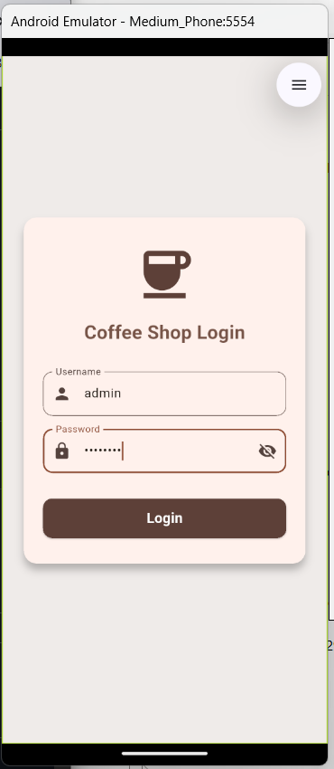
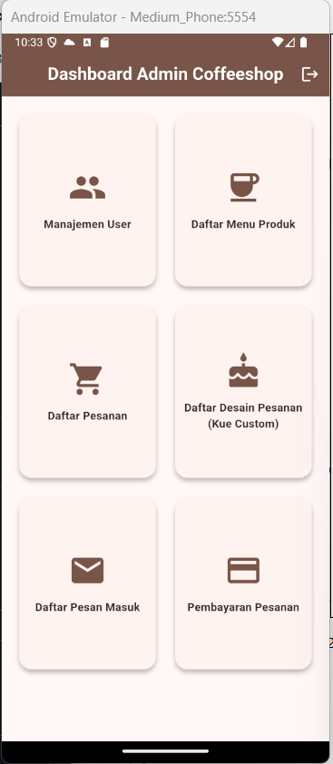

# ☕ Flutter Coffee Shop App

A mobile-based Point of Sale (POS) and order management system for coffee shops built using the **Flutter** framework, featuring menu management, multi-item ordering, payment transaction recording, custom order design uploads, user management, and contact message delivery.

---

## 📖 About the Application

The **Flutter Coffee Shop** application is designed to simplify daily cafe operational workflows:
1. Helping cashiers record customer orders quickly and accurately.
2. Facilitating custom orders with photo/design reference upload features.
3. Automatically calculating shopping totals, cash payments, and change.
4. Integrated with local database storage (SQLite) as well as a backend REST API architecture (Spring Boot + MySQL) for transaction data synchronization.

---

## 📷 Documentation & Demo

The following is a visualization of the Flutter application interface on an Android emulator:

| Feature | Documentation Preview | Description |
| :--- | :---: | :--- |
| **Login Page** |  | User login authentication page with account validation and username/password input forms. |
| **Admin Dashboard** |  | Main menu dashboard to access all Coffee Shop operational modules (User Management, Product Menu, Order List, Custom Cake Order Design, Incoming Messages, and Payments). |

> [!TIP]
> Application interface screenshots are stored in the `docs/screenshots/` folder and are ready to be displayed automatically when the repository is opened on GitHub.

---

## ✨ Key Features

- 🔐 **Authentication & Multi-Role Users**:
  - Login with role-based user authentication (`Admin` & `Cashier`).
  - User management (Add, Update, Delete cashier/admin accounts).
  - *Session Protection*: Automatic session protection when the application is minimized (background).

- 📋 **Catalog & Product Menu Management**:
  - Display list of coffee, non-coffee, and snack menus.
  - Menu CRUD (Create, Read, Update, Delete products along with prices, categories, and descriptions).

- 🛒 **Order Recording (Point of Sale)**:
  - Ticket generation with multi-item menus.
  - Automatic subtotal calculation per menu and cumulative total price.
  - Order status tracking (*Pending*, *Processing*, *Completed*).

- 💳 **Cashier & Payment Confirmation**:
  - Cashier page to validate customer cash payment amounts.
  - Instant calculation for change/return money.
  - Transaction payment status confirmation.

- 🎨 **Custom Order Design**:
  - Special ordering feature for customers (e.g., custom latte art, special cake toppers, or hampers packaging).
  - Camera & gallery integration (`image_picker`) to upload design photos/references.
  - Special instruction notes for baristas/kitchen staff.

- ✉️ **Messages & Contact**:
  - Form to send feedback, critiques, suggestions, or inquiries from customers.
  - Incoming contact message dashboard for management.

---

## 🛠 Tech Stack & Dependencies

- **Frontend / Client**: [Flutter](https://flutter.dev/) (Dart 3.x)
- **Local Storage / Persistence**:
  - `sqflite`: Offline-first relational database storage
  - `shared_preferences`: User session management & navigation status
- **Device Features**:
  - `image_picker`: Access gallery and camera for design photo uploads
  - `url_launcher`: Open external links
- **Backend / API (Optional / Integration)**:
  - Java Spring Boot REST API
  - MySQL (`ta_db_coffeeshop`) managed via HeidiSQL / phpMyAdmin

---

## 🚀 Guide to Run the Project

### 1. Running in Android Studio (Emulator)

1. Open **Android Studio**.
2. Open the **Tools** menu > **Device Manager** (or click the mobile icon in the right-side toolbar).
3. In the Virtual Device list, click the **Play** (▶️) button on your chosen emulator (e.g., `Medium Phone API 36` or `Pixel`).
4. Wait a few seconds until the Android system on the emulator boots up and enters the Home Screen.
5. Open this project in Android Studio or VS Code.
6. In the *Device Selector* dropdown, choose the running emulator's name.
7. Click the **Run** button (green triangle icon ▶️) or press shortcut `Shift + F10` (Android Studio) / `F5` (VS Code).

---

### 2. Running via Terminal / CLI

Ensure the Flutter SDK is installed and added to your system's PATH.

1. **Download Dependencies**:
   ```bash
   flutter pub get
   ```

2. **Check Active Devices**:
   ```bash
   flutter devices
   ```
   *Example output showing a ready emulator::*
   ```text
   sdk gphone64 x86 64 (mobile) • emulator-5554 • android-x64 • Android 16 (API 36)
   ```

3. **Run Application on Emulator**:
   ```bash
   flutter run -d emulator-5554
   ```
   *(Or simply type flutter run if there is only one active emulator device)*.

4. Wait until the `assembleDebug` build process completes and the application appears on the emulator screen.

---

### 3. Control Commands While Running (Hot Reload)

When the application is running through the terminal, use the following keys:
- **`r`** (lowercase) : **Hot Reload** (instantly updates UI code changes without restarting).
- **`R`** (uppercase) : **Hot Restart** (resets state and restarts the application from scratch).
- **`h`** : Show terminal shortcut help list.
- **`q`** : Stop the running application.

---

### 4. Build Release APK

To generate a ready-to-install APK file for a physical Android device:
```bash
flutter build apk --release
```
The output APK file will be saved at:
```text
build/app/outputs/flutter-apk/app-release.apk
```

---

## 🔑 Demo Accounts & Access

| Role | Username | Default Password | Description |
| :--- | :--- | :--- | :--- |
| **Admin** | `admin` | `admin123` | Full access permissions

*(Credentials can be adjusted or registered through the app's registration/user management menu).*
